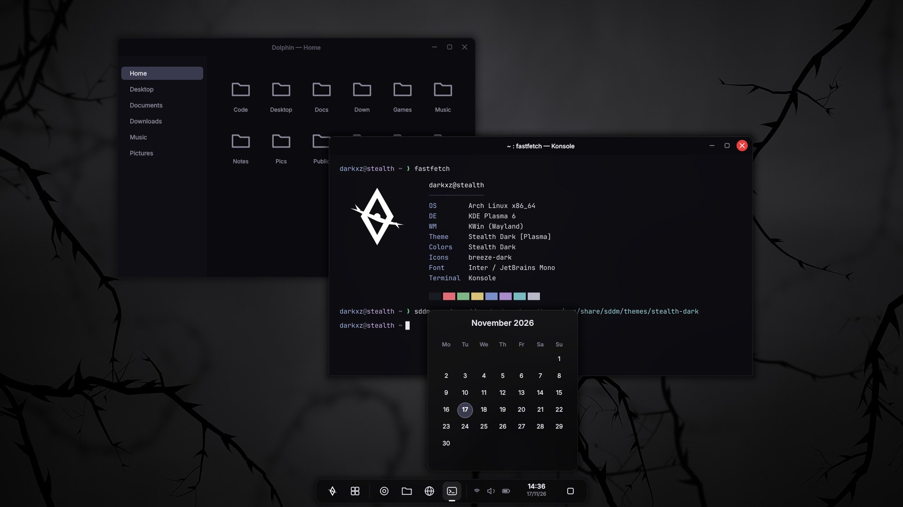

# 🖤 Stealth Dark para KDE Plasma 6

Tema completo para **KDE Plasma 6**: toma la estética glassmorphism oscura del tema
de login [Stealth Dark SDDM](https://github.com/madebydarkxz/stealth-dark-sddm) y la
lleva a todo el escritorio: colores, estilo de Plasma, decoración de ventanas, splash,
fondos, terminal y un greeter SDDM portado a Qt 6.



> La imagen del escritorio está **compuesta con los recursos reales del tema** (los SVG
> del estilo Plasma y de Aurorae, el esquema de colores y el fondo) mediante un
> renderizador de nueve porciones equivalente al de Plasma (`tools/desktop_preview.py`).
> No es una captura de una sesión de Plasma en marcha. Las capturas de SDDM y del splash
> sí son el QML real renderizado con Qt 6.

| Login (SDDM, Qt 6) | Splash |
|---|---|
|  |  |

---

## ✨ Qué incluye

| Componente | Ruta | Descripción |
|---|---|---|
| **Tema global** | `plasma/look-and-feel/org.kde.stealthdark.desktop` | Junta todo: colores, estilo, iconos, cursor, decoración, splash, fondo y una disposición de panel tipo dock flotante. |
| **Esquema de colores** | `color-schemes/StealthDark.colors` | La paleta negra/grafito del SDDM (`#050507`, `#22222e`, `#777788`…), con selección gris violáceo y rojo `#ff4444` para errores. |
| **Estilo de Plasma** | `plasma/desktoptheme/StealthDark` | Paneles, ventanas emergentes, tooltips y fondos de widgets como tarjetas de cristal: esquinas redondeadas, borde fino, blur y sombras suaves. Variantes `translucent/` (con blur), normal y `opaque/` (sin compositor). |
| **Decoración de ventanas** | `aurorae/themes/StealthDark` | Barra de título Aurorae oscura con esquinas redondeadas, sombra y botones circulares (el de cerrar se vuelve rojo). |
| **Splash** | `…/contents/splash/Splash.qml` | Tarjeta de cristal con el logo, reloj y barra de progreso por etapas. |
| **Fondos** | `wallpapers/StealthDark`, `wallpapers/StealthMist` | Espinas negras sobre humo oscuro (escritorio) y sobre niebla clara (login). Arte original generado por `tools/gen_wallpapers.py`, de 1920×1080 a 3840×2160 y ultrapanorámico. |
| **Konsole** | `konsole/` | Esquema de colores (con blur y 90 % de opacidad) y perfil con JetBrains Mono. |
| **SDDM** | `sddm/stealth-dark` | El login original portado a **Qt 6** (lo que usa SDDM con Plasma 6), con mejoras (ver abajo). |

### Mejoras en el tema SDDM
- Portado a Qt 6 (`QtQuick.Effects`), sin depender de `qt5-graphicaleffects` ni `qt6-5compat`.
- Diseño escalable: se adapta a cualquier resolución (el original tenía las posiciones del
  blur fijas para 1920×1080).
- Iconos SVG propios: ya no hace falta una Nerd Font para que se vean los iconos.
- Aviso de Bloq Mayús, mensaje y animación de sacudida si la contraseña es incorrecta,
  botón de entrar, botón de suspender, navegación con Tab.
- Textos en español o inglés según el idioma del sistema, y fecha localizada.
- Opciones en `theme.conf`: fondo, oscurecido, intensidad del blur, opacidad de las
  tarjetas, fuente, idioma, formato 12/24 h, nombre del sistema y logo (por ejemplo, el de
  tu distro).

---

## 📦 Requisitos

- **KDE Plasma 6** (escrito para la API de Plasma 6; no es compatible con Plasma 5).
- Para el login: **SDDM ≥ 0.21 compilado con Qt 6** (`sddm-greeter-qt6`), que es lo que
  traen las distros con Plasma 6.
- Recomendado: fuente **JetBrains Mono** (o JetBrainsMono Nerd Font) y la fuente **Inter**.

| Distro | Paquetes |
|---|---|
| Arch / CachyOS / Manjaro | `sudo pacman -S sddm qt6-declarative qt6-svg ttf-jetbrains-mono inter-font` |
| Fedora | `sudo dnf install sddm qt6-qtdeclarative qt6-qtsvg jetbrains-mono-fonts rsms-inter-fonts` |
| Debian / Ubuntu / KDE neon | `sudo apt install sddm qml6-module-qtquick qml6-module-qtquick-controls qml6-module-qtquick-effects qt6-svg-plugins fonts-jetbrains-mono fonts-inter` |
| openSUSE | `sudo zypper install sddm-qt6 qt6-declarative-imports qt6-svg jetbrains-mono-fonts` |

---

## 🛠️ Instalación

```bash
git clone https://github.com/user161803/kde_theme.git
cd kde_theme

./install.sh                 # instala la parte de Plasma en ~/.local/share (sin sudo)
./install.sh --apply         # …y además lo aplica todo ahora mismo
./install.sh --apply --layout  # …y sustituye tus paneles por el dock flotante del tema
./install.sh --sddm          # instala y activa el login (pide sudo)
./install.sh --all --apply   # todo de una vez
```

`--apply` aplica el tema global, el esquema de colores, el estilo de Plasma, la decoración
Aurorae, el fondo del escritorio y de la pantalla de bloqueo, el splash y el perfil de Konsole.

### Instalación manual desde la configuración del sistema
Tras `./install.sh`, en **Configuración del sistema › Colores y temas › Tema global**
elige **Stealth Dark**. Marca «Disposición del escritorio y de las ventanas» si quieres
también el panel tipo dock.

### Solo el login (SDDM)
```bash
sudo cp -r sddm/stealth-dark /usr/share/sddm/themes/
echo -e "[Theme]\nCurrent=stealth-dark" | sudo tee /etc/sddm.conf.d/stealth-dark.conf
sddm-greeter-qt6 --test-mode --theme /usr/share/sddm/themes/stealth-dark   # probar sin reiniciar
```
Si `/etc/sddm.conf` define `Current=` en `[Theme]`, tiene prioridad: cámbialo allí también.
También puedes seleccionarlo en **Configuración del sistema › Pantalla de inicio de sesión (SDDM)**.

### Desinstalar
```bash
./install.sh --uninstall          # parte de Plasma
./install.sh --uninstall --sddm   # login
```

---

## 🎨 Personalización

- **Fondo del login**: cambia `background=` en
  `/usr/share/sddm/themes/stealth-dark/theme.conf` (ruta relativa o absoluta). El fondo
  original del tema SDDM de madebydarkxz funciona tal cual.
- **Logo de tu distro en el login**: `logo=/usr/share/pixmaps/archlinux-logo.svg` y
  `systemName=Arch Linux`.
- **Iconos**: el tema usa `breeze-dark`, que siempre está instalado. Queda muy bien con
  [Papirus-Dark](https://github.com/PapirusDevelopmentTeam/papirus-icon-theme).
- **Estilo de aplicaciones**: Breeze con el esquema Stealth Dark. Si quieres más
  transparencia en las aplicaciones, combina con Kvantum.

## 🧰 Regenerar los recursos

Todo lo gráfico sale de scripts en `tools/` a partir de la paleta de `tools/palette.py`:

```bash
python3 tools/gen_colors.py       # .colors, colores del estilo Plasma y Konsole
python3 tools/gen_svgs.py         # SVG del estilo Plasma y de Aurorae
python3 tools/gen_wallpapers.py   # fondos (numpy + pillow)
python3 tools/validate_svgs.py    # comprueba los marcos de nueve porciones (PySide6)
xvfb-run -a tools/build_previews.sh   # capturas de docs/ (PySide6 + OpenGL)
```

Cambia un color en `palette.py`, ejecuta los generadores y todo el tema se mantiene
coherente.

---

## 📜 Créditos y licencia

- Diseño original del login: **[Stealth Dark SDDM](https://github.com/madebydarkxz/stealth-dark-sddm)**
  de **@madebydarkxz** (basado a su vez en el tema *Ronin*). Este proyecto porta ese diseño
  a Qt 6 y extiende su estética al resto de Plasma.
- Código, QML, SVG y scripts: **GPL-3.0-or-later** (ver `LICENSE`).
- Fondos `StealthDark` y `StealthMist`: arte original generado por `tools/gen_wallpapers.py`,
  **CC-BY-SA-4.0**. El fondo del repositorio original no se redistribuye aquí.
