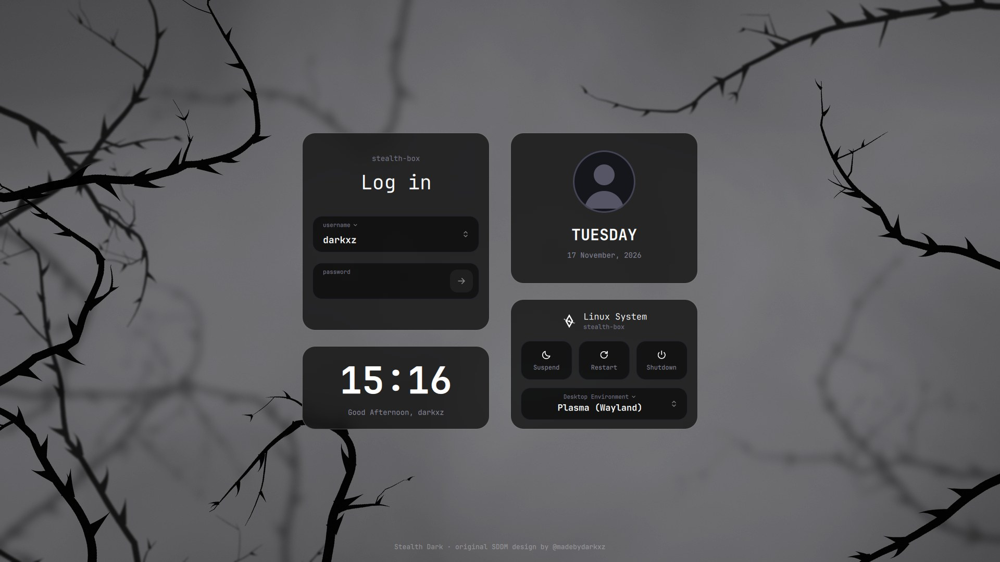
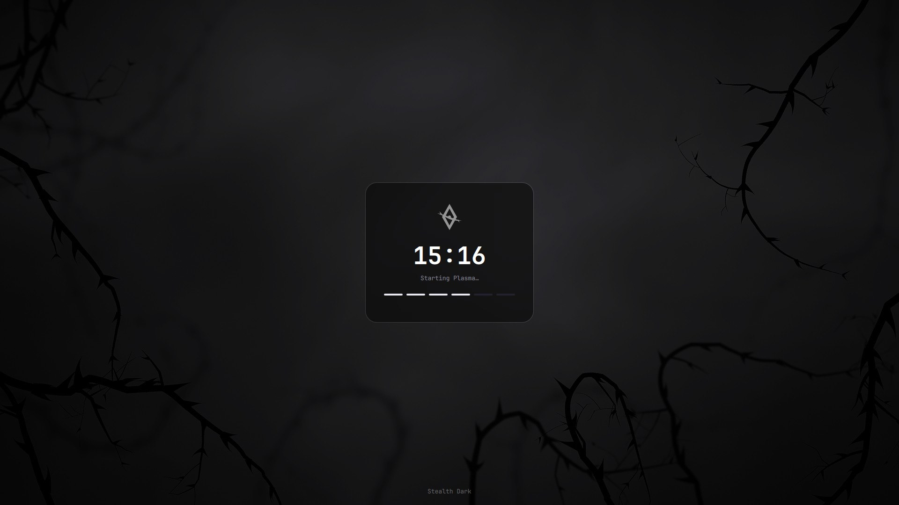

# 🖤 Stealth Dark para KDE Plasma 5 y 6

Tema completo para **KDE Plasma 5 (5.25+) y Plasma 6**: toma la estética glassmorphism oscura del tema
de login [Stealth Dark SDDM](https://github.com/madebydarkxz/stealth-dark-sddm) y la
lleva a todo el escritorio: colores, estilo de Plasma, decoración de ventanas, splash,
fondos, terminal y un greeter SDDM que funciona tanto con Qt 5 como con Qt 6.


> La imagen del escritorio está **compuesta con los recursos reales del tema** (los SVG
> del estilo Plasma y de Aurorae, el esquema de colores y el fondo) mediante un
> renderizador de nueve porciones equivalente al de Plasma (`tools/desktop_preview.py`).
> No es una captura de una sesión de Plasma en marcha. Las capturas de SDDM y del splash
> sí son el QML real renderizado con Qt 6 (y comprobado también con Qt 5.15, donde se ve igual).

| Login (SDDM) | Splash |
|---|---|
|  |  |

---

## ✨ Qué incluye

| Componente | Ruta | Descripción |
|---|---|---|
| **Tema global** | `plasma/look-and-feel/org.kde.stealthdark.desktop` | Junta todo: colores, estilo, iconos, cursor, decoración, splash, fondo y una disposición de panel tipo dock flotante. |
| **Esquema de colores** | `color-schemes/StealthDark.colors` | La paleta negra/grafito del SDDM (`#050507`, `#22222e`, `#777788`…), con selección gris violáceo y rojo `#ff4444` para errores. |
| **Estilo de Plasma** | `plasma/desktoptheme/StealthDark` | Paneles, ventanas emergentes, tooltips y fondos de widgets como tarjetas de cristal: esquinas redondeadas, borde fino, blur y sombras suaves. Variantes `translucent/` (con blur), normal y `opaque/` (sin compositor). |
| **Decoración de ventanas** | `aurorae/themes/StealthDark` | Barra de título Aurorae oscura con esquinas redondeadas, sombra y botones circulares (el de cerrar se vuelve rojo). |
| **Splash** | `…/contents/splash/Splash.qml` | Tarjeta de cristal con el logo, reloj y barra de progreso por etapas. |
| **Fondos** | `wallpapers/StealthDark`, `wallpapers/StealthMist` | Espinas negras sobre humo oscuro (escritorio) y sobre niebla clara (login). Arte original generado por `tools/gen_wallpapers.py`, de 1920×1080 a 3840×2160 y ultrapanorámico. |
| **Iconos** | `icons/StealthDark` | Carpetas grafito con emblemas plateados (personal, descargas, música…), papelera y el logo del tema en el menú de inicio. El resto de iconos se heredan de Papirus-Dark (opcional, `--papirus`) o de Breeze Dark. |
| **Konsole** | `konsole/` | Esquema de colores (con blur y 90 % de opacidad) y perfil con JetBrains Mono. |
| **SDDM** | `sddm/stealth-dark` | El login original, compatible con el greeter **Qt 5** (Plasma 5) y **Qt 6** (Plasma 6), con mejoras (ver abajo). |

### Mejoras en el tema SDDM
- Un único código QML para Qt 5 y Qt 6: los efectos (blur y esquinas redondeadas) se
  cargan con `QtQuick.Effects` en Qt 6 y con `QtGraphicalEffects` en Qt 5 (`FxLoader.qml`).
  En Qt 6 no hace falta `qt6-5compat`.
- Diseño escalable: se adapta a cualquier resolución (el original tenía las posiciones del
  blur fijas para 1920×1080).
- Iconos SVG propios: ya no hace falta una Nerd Font para que se vean los iconos.
- Aviso de Bloq Mayús, mensaje y animación de sacudida si la contraseña es incorrecta,
  botón de entrar, botón de suspender, navegación con Tab.
- Textos en español o inglés según el idioma del sistema, y fecha localizada.
- Opciones en `theme.conf`: fondo, oscurecido, intensidad del blur, opacidad de las
  tarjetas, fuente, idioma, formato 12/24 h, nombre del sistema y logo (por ejemplo, el de
  tu distro).

---

## 📦 Requisitos

- **KDE Plasma 5.25 o superior, o Plasma 6.** Todos los paquetes llevan `metadata.desktop`
  (Plasma 5) y `metadata.json` (Plasma 6). En Plasma 5.24 o anterior funciona todo menos el
  panel flotante.
- Para el login: **SDDM** con el greeter Qt 5 (`sddm-greeter`, lo habitual con Plasma 5)
  o Qt 6 (`sddm-greeter-qt6`, SDDM ≥ 0.21, lo habitual con Plasma 6). El instalador
  detecta cuál tienes.
- Recomendado: fuente **JetBrains Mono** (o JetBrainsMono Nerd Font) y la fuente **Inter**.

**Plasma 6 / SDDM Qt 6**

| Distro | Paquetes |
|---|---|
| Arch / CachyOS / Manjaro | `sudo pacman -S sddm qt6-declarative qt6-svg ttf-jetbrains-mono inter-font` |
| Fedora | `sudo dnf install sddm qt6-qtdeclarative qt6-qtsvg jetbrains-mono-fonts rsms-inter-fonts` |
| Debian / Ubuntu / KDE neon | `sudo apt install sddm qml6-module-qtquick qml6-module-qtquick-controls qml6-module-qtquick-effects qt6-svg-plugins fonts-jetbrains-mono fonts-inter` |
| openSUSE | `sudo zypper install sddm-qt6 qt6-declarative-imports qt6-svg jetbrains-mono-fonts` |

**Plasma 5 / SDDM Qt 5**

| Distro | Paquetes |
|---|---|
| Arch / Manjaro (con Plasma 5) | `sudo pacman -S sddm qt5-graphicaleffects qt5-quickcontrols2 qt5-svg ttf-jetbrains-mono` |
| Debian 12 / Ubuntu 22.04–24.04 / Kubuntu | `sudo apt install sddm qml-module-qtgraphicaleffects qml-module-qtquick-controls2 qml-module-qtquick-layouts libqt5svg5 fonts-jetbrains-mono` |
| Fedora (con Plasma 5) | `sudo dnf install sddm qt5-qtgraphicaleffects qt5-qtquickcontrols2 qt5-qtsvg jetbrains-mono-fonts` |
| openSUSE Leap | `sudo zypper install sddm libqt5-qtgraphicaleffects libqt5-qtquickcontrols2 libqt5-qtsvg` |

---

## 🛠️ Instalación

```bash
git clone https://github.com/user161803/kde_theme.git
cd kde_theme

./install.sh                 # instala la parte de Plasma en ~/.local/share (sin sudo)
./install.sh --apply         # …y además lo aplica todo ahora mismo
./install.sh --apply --layout  # …y sustituye tus paneles por el dock flotante del tema (guarda copia)
./install.sh --apply --papirus # …y descarga Papirus-Dark para los iconos de aplicaciones (sin sudo)
./install.sh --sddm          # instala y activa el login (pide sudo)
./install.sh --all --apply   # todo de una vez
```

`--apply` aplica el tema global, el esquema de colores, el estilo de Plasma, la decoración
Aurorae, el fondo del escritorio y de la pantalla de bloqueo, el splash y el perfil de Konsole.
Usa las herramientas de Plasma 6 o de Plasma 5 (`plasma-apply-*`/`lookandfeeltool`,
`kwriteconfig6`/`kwriteconfig5`) según lo que encuentre.

Con `--layout`, en Plasma 6.1+ el dock se ajusta al contenido; en Plasma 5 y 6.0 (que no
tienen esa opción) se crea con un ancho fijo centrado, que puedes cambiar desde «Editar
panel».

### Instalación manual desde la configuración del sistema
Tras `./install.sh`, en **Configuración del sistema › Colores y temas › Tema global**
(en Plasma 5: **Apariencia › Tema global**) elige **Stealth Dark**. Marca «Disposición del escritorio y de las ventanas» si quieres
también el panel tipo dock.

### Solo el login (SDDM)
```bash
sudo cp -r sddm/stealth-dark /usr/share/sddm/themes/
echo -e "[Theme]\nCurrent=stealth-dark" | sudo tee /etc/sddm.conf.d/stealth-dark.conf

# Solo Plasma 5 / greeter Qt 5: quita la línea QtVersion=6
sudo sed -i '/^QtVersion=/d' /usr/share/sddm/themes/stealth-dark/metadata.desktop

# Probar sin reiniciar
sddm-greeter-qt6 --test-mode --theme /usr/share/sddm/themes/stealth-dark   # Plasma 6
sddm-greeter --test-mode --theme /usr/share/sddm/themes/stealth-dark       # Plasma 5
```
`./install.sh --sddm` hace todo esto solo. Para forzar una versión:
`STEALTH_SDDM_QT=5 ./install.sh --sddm`.
Si `/etc/sddm.conf` define `Current=` en `[Theme]`, tiene prioridad: cámbialo allí también.
También puedes seleccionarlo en **Configuración del sistema › Pantalla de inicio de sesión (SDDM)**.

### Desinstalar
```bash
./install.sh --uninstall          # parte de Plasma
./install.sh --uninstall --sddm   # login
```

---

## 🩺 Si algo no se aplica

```bash
./install.sh --diagnose      # muestra qué tema, colores, decoración, etc. están activos
```

- **El panel no cambia**: ejecuta `./install.sh --apply --layout`. El instalador sustituye
  los paneles directamente a través de plasmashell (D-Bus), porque algunas distribuciones
  (por ejemplo LliureX) ignoran o restauran el «reinicio de disposición» del tema global.
  Antes guarda una copia: `~/.config/plasma-org.kde.plasma.desktop-appletsrc.before-stealth-dark.*`.
  Para volver al panel anterior, copia ese fichero sobre el original y reinicia la sesión.
- **La barra de título no cambia**: si no hay `qdbus`, KWin no siempre se recarga; cierra la
  sesión y vuelve a entrar. También puedes elegirla en *Configuración del sistema ›
  Apariencia › Decoraciones de ventanas › Stealth Dark*.
- **Konsole sigue igual**: las ventanas que ya estaban abiertas conservan su perfil; abre una
  nueva. JetBrains Mono viene incluida en `fonts/` y el instalador la instala en
  `~/.local/share/fonts` si no la tienes (no hace falta sudo).
- **Sin sudo**: todo lo de Plasma se instala en tu carpeta personal. Solo el login (SDDM)
  necesita permisos de administrador, porque vive en `/usr/share/sddm/themes`.
- **Los iconos no cambian**: `--diagnose` muestra el tema de iconos activo y si el sistema
  lo tiene bloqueado (líneas `LOCKED`, típico de equipos gestionados como LliureX); en ese caso
  solo un administrador puede cambiarlo. Los iconos de las aplicaciones solo cambian con
  `--papirus`. El panel puede necesitar cerrar sesión para recargar los iconos.
- **El panel no es translúcido**: en máquinas virtuales o sin aceleración gráfica KWin
  desactiva el desenfoque, y Plasma usa la variante opaca del estilo.

## 🎨 Personalización

- **Fondo del login**: cambia `background=` en
  `/usr/share/sddm/themes/stealth-dark/theme.conf` (ruta relativa o absoluta). El fondo
  original del tema SDDM de madebydarkxz funciona tal cual.
- **Logo de tu distro en el login**: `logo=/usr/share/pixmaps/archlinux-logo.svg` y
  `systemName=Arch Linux`.
- **Iconos**: el tema de iconos Stealth Dark solo redibuja carpetas, papelera y el lanzador;
  los iconos de aplicaciones vienen de [Papirus-Dark](https://github.com/PapirusDevelopmentTeam/papirus-icon-theme)
  si lo instalas con `--papirus` (con carpetas en gris), o de Breeze Dark si no.
- **Estilo de aplicaciones**: Breeze con el esquema Stealth Dark. Si quieres más
  transparencia en las aplicaciones, combina con Kvantum.

## 🧰 Regenerar los recursos

Todo lo gráfico sale de scripts en `tools/` a partir de la paleta de `tools/palette.py`:

```bash
python3 tools/gen_colors.py       # .colors, colores del estilo Plasma y Konsole
python3 tools/gen_svgs.py         # SVG del estilo Plasma y de Aurorae
python3 tools/gen_icons.py        # tema de iconos
python3 tools/gen_wallpapers.py   # fondos (numpy + pillow)
python3 tools/validate_svgs.py    # comprueba los marcos de nueve porciones (PySide6)
xvfb-run -a tools/build_previews.sh   # capturas de docs/ (PySide6 + OpenGL)

# Probar el login y el splash con Qt 5 (como en Plasma 5), con PyQt5 instalado:
xvfb-run -a python3 tools/sddm_preview.py /tmp/sddm-qt5.png --qt5
xvfb-run -a python3 tools/splash_preview.py /tmp/splash-qt5.png --qt5
```

Cambia un color en `palette.py`, ejecuta los generadores y todo el tema se mantiene
coherente.

---

## 📜 Créditos y licencia

- Diseño original del login: **[Stealth Dark SDDM](https://github.com/madebydarkxz/stealth-dark-sddm)**
  de **@madebydarkxz** (basado a su vez en el tema *Ronin*). Este proyecto adapta ese diseño
  a Qt 5 y Qt 6 y extiende su estética al resto de Plasma.
- Código, QML, SVG y scripts: **GPL-3.0-or-later** (ver `LICENSE`).
- Fondos `StealthDark` y `StealthMist`: arte original generado por `tools/gen_wallpapers.py`,
  **CC-BY-SA-4.0**.
- Fuente incluida: **JetBrains Mono** © JetBrains, ver `fonts/JetBrainsMono/README.md`. El fondo del repositorio original no se redistribuye aquí.
